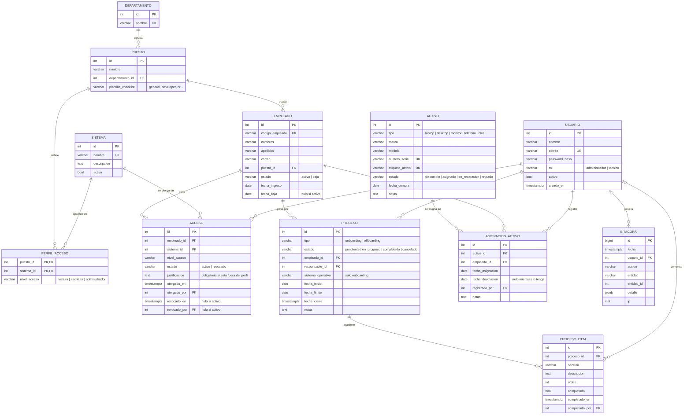

# Modelo de datos del prototipo

**Base de datos:** PostgreSQL
**Acceso desde la aplicación:** Flask-SQLAlchemy (modelos), Flask-Migrate/Alembic (migraciones), Flask-Login (sesiones)
**Estado:** propuesta de diseño, todavía sin implementar
**Relación con la tesis:** ver [ALINEACION.md](ALINEACION.md)

---

## 1. Diagrama entidad-relación



**Cómo leer las líneas:** `||--o{` significa "uno a muchos". Por ejemplo, un puesto puede tener muchos empleados, y cada empleado tiene un solo puesto. `|o--o{` significa que el lado izquierdo es opcional. Por ejemplo, un ítem todavía no completado no tiene usuario.

**Abreviaturas:** PK = llave primaria (el número que identifica cada fila). FK = llave foránea (un campo que apunta a una fila de otra tabla). UK = valor único (no se puede repetir).

---

## 2. Descripción de cada tabla

### 2.1 USUARIO: quién entra a la aplicación

Son las personas de TI que usan el sistema, no los empleados de la empresa.

| Campo | Tipo | Explicación |
|---|---|---|
| `id` | entero, PK | Número interno de cada usuario. |
| `nombre` | texto (hasta 120) | Nombre visible. |
| `correo` | texto (hasta 255), único | Se usa para iniciar sesión. |
| `password_hash` | texto (hasta 255) | La contraseña cifrada. La contraseña real nunca se guarda. |
| `rol` | texto con valores fijos: `administrador`, `tecnico` | Define qué puede hacer el usuario (mínimo privilegio aplicado a la propia aplicación). |
| `activo` | sí/no | Los usuarios no se borran, se desactivan. Así la bitácora conserva quién hizo cada acción. |
| `creado_en` | fecha y hora | Cuándo se creó el usuario. |

**Permisos por rol:**

| Acción | Administrador | Técnico |
|---|---|---|
| Gestionar usuarios de la aplicación | Sí | No |
| Gestionar departamentos, puestos, sistemas y perfiles de acceso | Sí | No |
| Registrar empleados, ejecutar procesos, marcar ítems | Sí | Sí |
| Otorgar y revocar accesos, asignar y recibir activos | Sí | Sí |
| Ver cuentas huérfanas | Sí | Sí |
| Ver la bitácora de auditoría | Sí | No |

### 2.2 DEPARTAMENTO: áreas de la empresa

| Campo | Tipo | Explicación |
|---|---|---|
| `id` | entero, PK | Número interno. |
| `nombre` | texto (hasta 100), único | Ejemplos: Finanzas, Ventas, Recursos Humanos. |

### 2.3 PUESTO: cargo dentro de un departamento

| Campo | Tipo | Explicación |
|---|---|---|
| `id` | entero, PK | Número interno. |
| `nombre` | texto (hasta 100) | Ejemplos: Contador, Desarrollador. |
| `departamento_id` | entero, FK → DEPARTAMENTO | A qué departamento pertenece. |
| `plantilla_checklist` | texto (hasta 50) | Qué plantilla de `checklists/roles/*.yaml` se usa en su onboarding (`general`, `developer`, `finance`, etc.). Así se conecta el modelo nuevo con el contenido que ya existe. |

### 2.4 EMPLEADO: personas de la empresa cliente

| Campo | Tipo | Explicación |
|---|---|---|
| `id` | entero, PK | Número interno. |
| `codigo_empleado` | texto (hasta 30), único | Código que usa la empresa (por ejemplo, de planilla). |
| `nombres`, `apellidos` | texto (hasta 100 cada uno) | Nombre del empleado. |
| `correo` | texto (hasta 255), opcional | Correo corporativo. |
| `puesto_id` | entero, FK → PUESTO | Su puesto. De aquí salen los accesos que le corresponden. |
| `estado` | texto con valores fijos: `activo`, `baja` | Si sigue trabajando o no. Es clave para detectar cuentas huérfanas. |
| `fecha_ingreso` | fecha | Primer día de trabajo. |
| `fecha_baja` | fecha, opcional | Último día. Vacío mientras esté activo. |

Solo se guardan los datos personales necesarios para el proceso de TI. No se guardan número de identidad, dirección ni salario.

### 2.5 SISTEMA: aplicaciones o servicios a los que se da acceso

| Campo | Tipo | Explicación |
|---|---|---|
| `id` | entero, PK | Número interno. |
| `nombre` | texto (hasta 100), único | Ejemplos: Correo Microsoft 365, ERP, VPN, CRM. |
| `descripcion` | texto largo, opcional | Para qué sirve. |
| `activo` | sí/no | Permite retirar un sistema sin perder su historial. |

### 2.6 PERFIL_ACCESO: qué accesos le tocan a cada puesto

Es la tabla que demuestra el **mínimo privilegio**. Cada fila dice: "el puesto X debe tener acceso al sistema Y con nivel Z".

| Campo | Tipo | Explicación |
|---|---|---|
| `puesto_id` | entero, PK y FK → PUESTO | El puesto. |
| `sistema_id` | entero, PK y FK → SISTEMA | El sistema. |
| `nivel_acceso` | texto con valores fijos: `lectura`, `escritura`, `administrador` | El nivel máximo permitido. |

La llave primaria está formada por los dos campos juntos, así un puesto no puede tener el mismo sistema dos veces.

### 2.7 ACCESO: accesos reales que tiene cada empleado

| Campo | Tipo | Explicación |
|---|---|---|
| `id` | entero, PK | Número interno. |
| `empleado_id` | entero, FK → EMPLEADO | A quién se le dio el acceso. |
| `sistema_id` | entero, FK → SISTEMA | A qué sistema. |
| `nivel_acceso` | texto con valores fijos (los mismos de PERFIL_ACCESO) | Nivel otorgado. |
| `estado` | texto con valores fijos: `activo`, `revocado` | Si la cuenta sigue abierta. |
| `justificacion` | texto largo, opcional | Obligatoria cuando el acceso no está en el perfil del puesto, o cuando supera el nivel del perfil. |
| `otorgado_en` | fecha y hora | Cuándo se dio. |
| `otorgado_por` | entero, FK → USUARIO | Qué técnico lo dio. |
| `revocado_en` | fecha y hora, opcional | Cuándo se quitó. |
| `revocado_por` | entero, FK → USUARIO, opcional | Qué técnico lo quitó. |

**Regla:** un empleado no puede tener dos accesos *activos* al mismo sistema. Se garantiza con un índice único parcial de PostgreSQL sobre (`empleado_id`, `sistema_id`) donde `estado = 'activo'`. Los accesos revocados se conservan como historial.

### 2.8 PROCESO: un onboarding o un offboarding

| Campo | Tipo | Explicación |
|---|---|---|
| `id` | entero, PK | Número interno. |
| `tipo` | texto con valores fijos: `onboarding`, `offboarding` | Entrada o salida. |
| `estado` | texto con valores fijos: `pendiente`, `en_progreso`, `completado`, `cancelado` | Avance del proceso. |
| `empleado_id` | entero, FK → EMPLEADO | A quién se le hace el proceso. |
| `responsable_id` | entero, FK → USUARIO | Técnico a cargo. |
| `sistema_operativo` | texto, opcional | Solo en onboarding: `windows`, `macos`, `linux`, `remote` o `custom`. Indica qué plantilla de `checklists/*.yaml` se usa. |
| `fecha_inicio` | fecha | Cuándo empieza. |
| `fecha_limite` | fecha, opcional | Para cuándo debe estar listo. |
| `fecha_cierre` | fecha y hora, opcional | Cuándo se completó o canceló. |
| `notas` | texto largo, opcional | Observaciones. |

**Reglas:**
- Un empleado no puede tener dos procesos abiertos del mismo tipo a la vez (índice único parcial).
- Al **completar un offboarding**, el empleado pasa a `estado = 'baja'` y se llena su `fecha_baja`.

### 2.9 PROCESO_ITEM: cada tarea del checklist

| Campo | Tipo | Explicación |
|---|---|---|
| `id` | entero, PK | Número interno. |
| `proceso_id` | entero, FK → PROCESO | A qué proceso pertenece. |
| `seccion` | texto (hasta 150) | Título de la sección (por ejemplo, "Accounts & Access"). |
| `descripcion` | texto largo | La tarea. |
| `orden` | entero | Posición en la lista. |
| `completado` | sí/no | Si ya se hizo. |
| `completado_en` | fecha y hora, opcional | Cuándo se marcó. |
| `completado_por` | entero, FK → USUARIO, opcional | Quién la marcó. |

**De dónde salen los ítems:**
- **Onboarding:** se generan con la función que ya existe, `load_checklist()` en `app/pdf_generator.py`. Usa el YAML del sistema operativo y el de la plantilla del puesto.
- **Offboarding:** se generan desde un YAML nuevo de offboarding, más un ítem por cada acceso activo ("Revocar acceso a ERP") y uno por cada activo asignado ("Recuperar laptop serie ABC123").

El texto se **copia** a la tabla en el momento de crear el proceso. Si mañana se edita un YAML, los procesos viejos conservan lo que realmente se les asignó.

### 2.10 ACTIVO: inventario de equipos

| Campo | Tipo | Explicación |
|---|---|---|
| `id` | entero, PK | Número interno. |
| `tipo` | texto con valores fijos: `laptop`, `desktop`, `monitor`, `telefono`, `otro` | Clase de equipo. |
| `marca`, `modelo` | texto (hasta 100 cada uno) | Ejemplo: Dell, Latitude 5440. |
| `numero_serie` | texto (hasta 100), único | Serie del fabricante. |
| `etiqueta_activo` | texto (hasta 50), único, opcional | Etiqueta interna de la empresa. |
| `estado` | texto con valores fijos: `disponible`, `asignado`, `en_reparacion`, `retirado` | Situación actual. La aplicación lo actualiza al asignar o devolver. |
| `fecha_compra` | fecha, opcional | Fecha de adquisición. |
| `notas` | texto largo, opcional | Observaciones. |

### 2.11 ASIGNACION_ACTIVO: quién tiene o tuvo cada equipo

| Campo | Tipo | Explicación |
|---|---|---|
| `id` | entero, PK | Número interno. |
| `activo_id` | entero, FK → ACTIVO | Qué equipo. |
| `empleado_id` | entero, FK → EMPLEADO | A quién se le entregó. |
| `fecha_asignacion` | fecha | Cuándo se entregó. |
| `fecha_devolucion` | fecha, opcional | Cuándo lo devolvió. Vacío mientras lo tenga. |
| `registrado_por` | entero, FK → USUARIO | Técnico que registró la entrega. |
| `notas` | texto largo, opcional | Estado del equipo al entregar o recibir. |

**Regla:** un equipo solo puede tener una asignación abierta a la vez (índice único parcial sobre `activo_id` donde `fecha_devolucion` está vacía).

### 2.12 BITACORA: registro de auditoría

| Campo | Tipo | Explicación |
|---|---|---|
| `id` | entero grande, PK | Número interno. Es la tabla que más crece. |
| `fecha` | fecha y hora | Se llena automáticamente. |
| `usuario_id` | entero, FK → USUARIO, opcional | Quién hizo la acción. Vacío si la hizo el sistema o fue un intento de inicio de sesión fallido. |
| `accion` | texto (hasta 50) | Ejemplos: `iniciar_sesion`, `crear_empleado`, `completar_item`, `otorgar_acceso`, `revocar_acceso`, `asignar_activo`, `cerrar_proceso`. |
| `entidad` | texto (hasta 50) | Qué tabla se afectó (por ejemplo, `acceso`). |
| `entidad_id` | entero, opcional | Qué fila de esa tabla. |
| `detalle` | JSONB, opcional | Datos extra, como el valor anterior y el nuevo. |
| `ip` | dirección IP, opcional | Desde dónde se hizo la acción. |

La aplicación **solo agrega** filas a esta tabla: no tiene pantallas para editarla ni borrarla. `entidad_id` no es una llave foránea porque puede apuntar a distintas tablas. Por eso se guarda junto con el nombre de la tabla en `entidad`.

---

## 3. Consultas clave para la demostración

Estas consultas no necesitan tablas propias. Se calculan con los datos que ya hay.

**Cuentas huérfanas.** Empleados dados de baja que todavía tienen accesos activos:

```sql
SELECT e.codigo_empleado, e.nombres, e.apellidos, e.fecha_baja,
       s.nombre AS sistema, a.nivel_acceso, a.otorgado_en
FROM acceso a
JOIN empleado e ON e.id = a.empleado_id
JOIN sistema  s ON s.id = a.sistema_id
WHERE e.estado = 'baja'
  AND a.estado = 'activo';
```

**Accesos fuera de perfil.** Accesos activos que el puesto del empleado no contempla y que no tienen justificación:

```sql
SELECT e.codigo_empleado, e.nombres, s.nombre AS sistema, a.nivel_acceso
FROM acceso a
JOIN empleado e ON e.id = a.empleado_id
JOIN sistema  s ON s.id = a.sistema_id
LEFT JOIN perfil_acceso p
       ON p.puesto_id = e.puesto_id AND p.sistema_id = a.sistema_id
WHERE a.estado = 'activo'
  AND p.puesto_id IS NULL
  AND a.justificacion IS NULL;
```

Esta segunda consulta no detecta un acceso que esté en el perfil pero con un nivel más alto que el permitido. Para eso hay que comparar `a.nivel_acceso` con `p.nivel_acceso` usando el orden `lectura` < `escritura` < `administrador`. Esa comparación se hará en la aplicación.

---

## 4. Relación entre entidades y requisitos de la tesis

| Requisito de la tesis | Capítulo | Entidades que lo cubren |
|---|---|---|
| Gestión de identidades y accesos | II y VI | USUARIO, SISTEMA, PERFIL_ACCESO, ACCESO |
| Mínimo privilegio: usuarios de la aplicación con roles | II y VI | USUARIO (`rol`) |
| Mínimo privilegio: accesos del empleado definidos por su puesto | II y VI | PUESTO, PERFIL_ACCESO, ACCESO (`justificacion`), consulta "accesos fuera de perfil" |
| Cuentas huérfanas: registro y detección | II y VI | EMPLEADO (`estado`), ACCESO (`estado`), consulta "cuentas huérfanas" |
| PostgreSQL | II | Todo el modelo |
| Flujo de onboarding | VI | PROCESO (`tipo = onboarding`), PROCESO_ITEM, ACCESO (otorgar), ASIGNACION_ACTIVO (entregar) |
| Flujo de offboarding | VI | PROCESO (`tipo = offboarding`), PROCESO_ITEM, ACCESO (revocar), ASIGNACION_ACTIVO (devolver), EMPLEADO (`estado = baja`) |
| Inventario de activos | VI | ACTIVO, ASIGNACION_ACTIVO |
| Bitácora de auditoría | VI | BITACORA |
| Organización de la empresa (tabla de apoyo) | — | DEPARTAMENTO |
| Flask, Docker | II | No son entidades: son la tecnología con la que se construye y ejecuta el modelo |

---

## 5. Decisiones de diseño

| Decisión | Por qué |
|---|---|
| Se agregaron DEPARTAMENTO y PUESTO como tablas, en vez de guardarlos como texto dentro de EMPLEADO | El requisito de mínimo privilegio dice que los accesos se definen *por puesto*, así que el puesto necesita su propia tabla a la cual colgarle un perfil. Departamento evita que la misma área se escriba de formas distintas. |
| Se agregó PERFIL_ACCESO | Sin ella no hay manera de comparar "lo que el empleado tiene" contra "lo que debería tener", que es justo lo que pide el requisito de mínimo privilegio. |
| ACTIVO y su asignación van en tablas separadas | Un equipo pasa por varios empleados a lo largo de su vida. Separarlos guarda el historial completo de quién tuvo cada equipo. |
| Las cuentas huérfanas son una consulta, no una tabla | Se calculan con datos que ya existen (estado del empleado y estado del acceso). Guardarlas en una tabla aparte podría dejar datos desactualizados. |
| El rol del usuario es un campo de valores fijos, no una tabla de roles y permisos | La tesis pide solo dos roles fijos. Una tabla de permisos agregaría complejidad que el prototipo no necesita. |
| Los valores fijos (`estado`, `tipo`, `rol`…) se guardan como texto con una restricción CHECK, no como el tipo ENUM de PostgreSQL | Es más fácil agregar un valor nuevo después: el ENUM nativo es difícil de modificar con migraciones. En SQLAlchemy esto se logra con `Enum(..., native_enum=False)`. |
| Los ítems del proceso copian el texto del YAML | Si se edita un YAML, los procesos viejos conservan lo que realmente se les asignó. |
| Usuarios y sistemas se desactivan, no se borran | Las referencias desde la bitácora y el historial siguen siendo válidas. |
